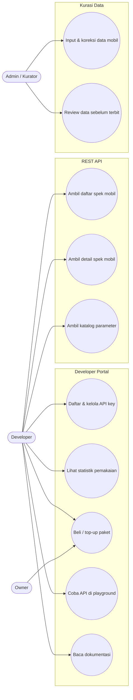
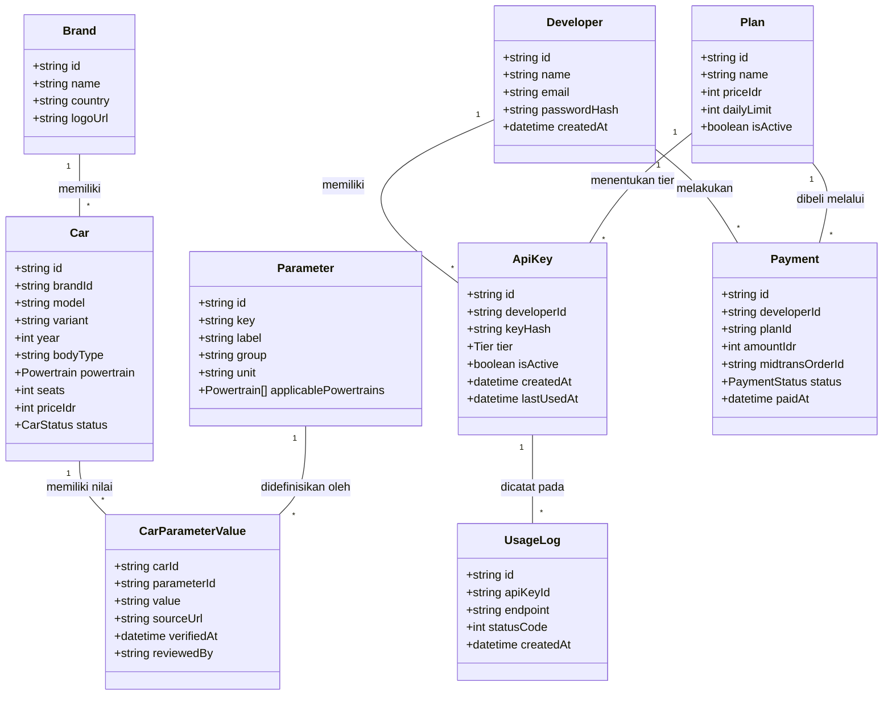
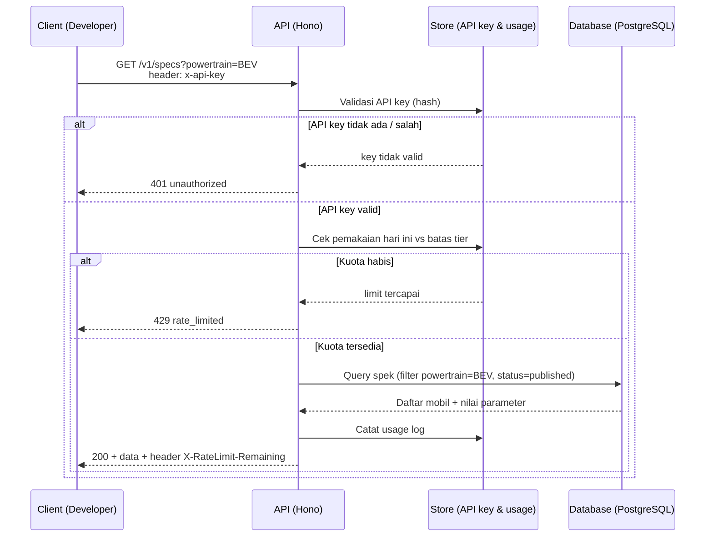
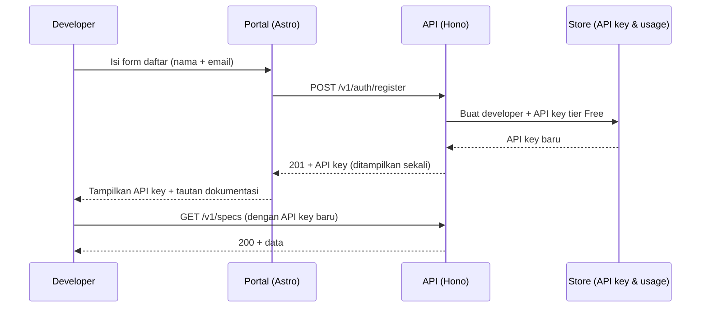
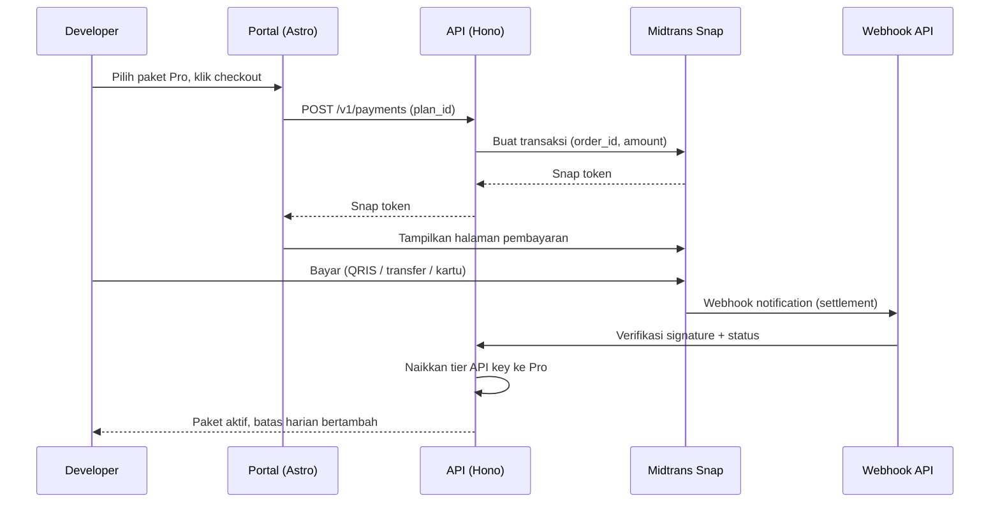
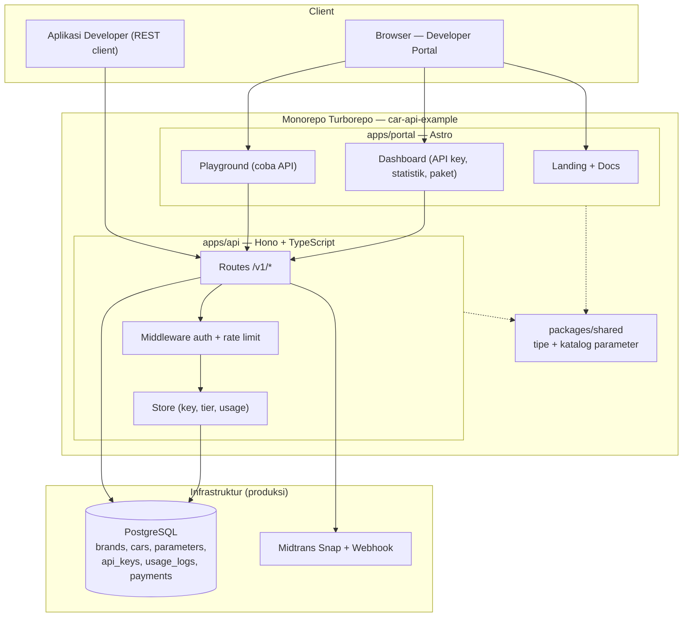
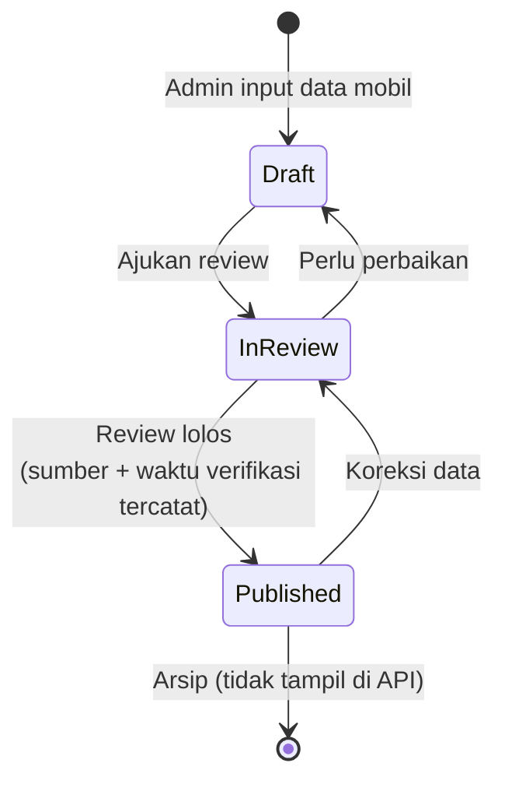

# UML — Car Web API

Diagram-diagram di bawah memakai [Mermaid](https://mermaid.js.org/),
yang dirender langsung oleh GitHub pada file Markdown ini. Diagram
mencerminkan implementasi pada repository ini (monorepo Turborepo:
`apps/api` Hono + TypeScript, `apps/portal` Astro, `packages/shared`)
dan kebutuhan pada
[`Software_Requirement_Specification.md`](Software_Requirement_Specification.md).

---

## 1. Use Case Diagram

Keterangan: Developer adalah pengguna API (FR-11 s.d. FR-17).
Admin/Kurator mengelola data dan alur review (FR-18 s.d. FR-21).
Owner menentukan harga paket dan menyediakan akun Midtrans.

---

## 2. Class Diagram (Model Data)

Catatan: `powertrain` memakai taksonomi ICE, MHEV, FHEV, PHEV, REEV,
BEV, FCEV, PFCEV. `status` mobil: `draft`, `in_review`, `published`
— hanya `published` yang tampil di API publik (FR-20).

---

## 3. Sequence Diagram — Permintaan API

Memenuhi FR-01, FR-05, FR-06, FR-07, FR-09, dan FR-10.

---

## 4. Sequence Diagram — Registrasi & Penerbitan API Key

Memenuhi FR-11 dan FR-12 (regenerate dan revoke memakai alur yang
sama: API key lama dinonaktifkan, key baru diterbitkan).

---

## 5. Sequence Diagram — Top-up Paket via Midtrans

Memenuhi FR-15. Akun Midtrans disediakan owner (lihat SRS bagian 8).
Pada prototype, langkah ini masih placeholder — lihat README.

---

## 6. Component Diagram

Pada prototype, `Store` dan data memakai in-memory (lihat
`apps/api/src/store.ts` dan `apps/api/src/data.ts`); pada produksi
diganti PostgreSQL tanpa mengubah kontrak API.

---

## 7. State Diagram — Status Kurasi Data

Hanya data berstatus `Published` yang dikembalikan API publik (FR-20).
